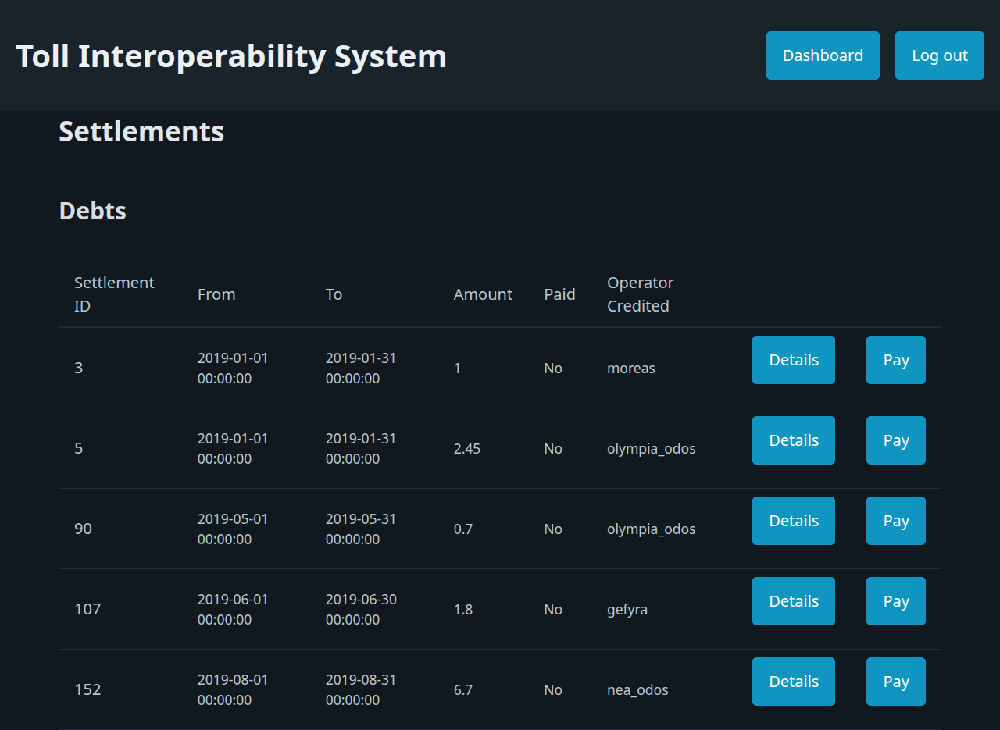
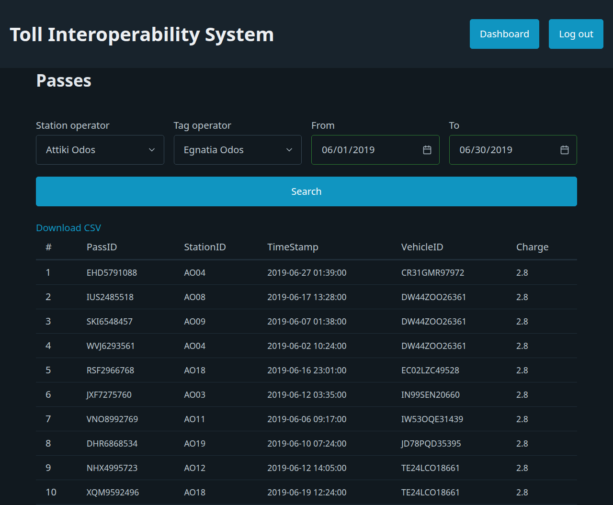
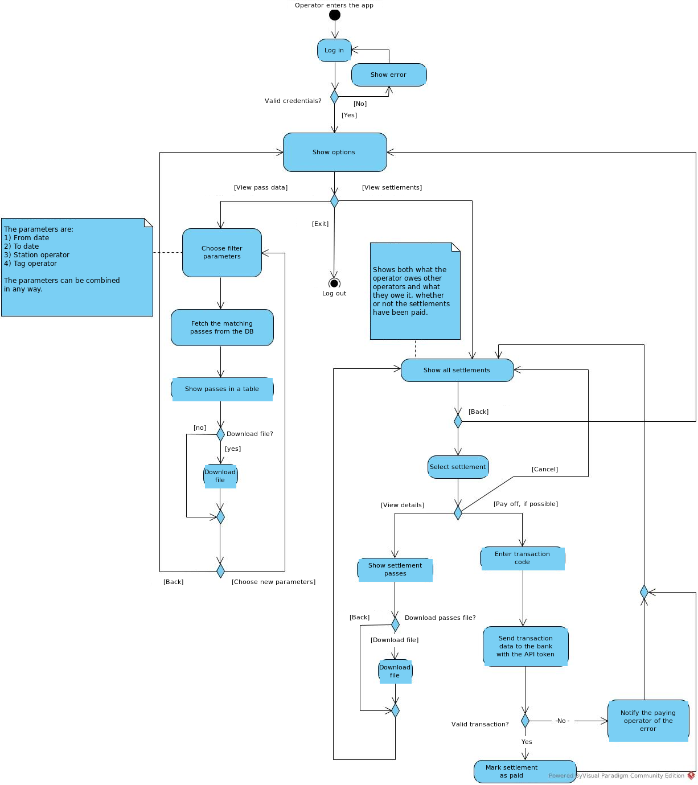
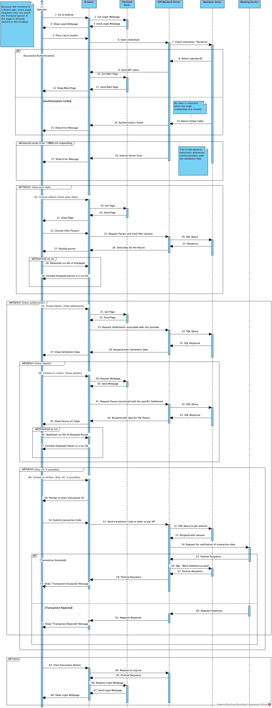
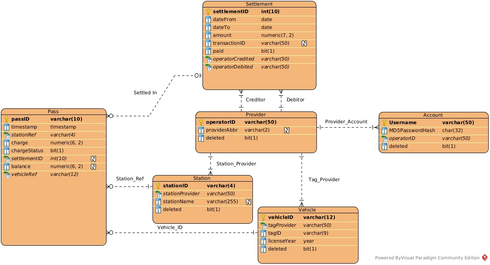

# Toll Interoperability System

A web platform that lets Greek motorway operators settle toll charges with each other. When a vehicle with one operator's e-tag passes through another operator's toll station, the system records the pass, nets out what each operator owes the others every month, and lets operators review the passes and mark the settlements as paid.

Built as the semester project for the *Software Engineering* course at the School of Electrical & Computer Engineering, National Technical University of Athens (NTUA), 2021–22.



*The settlements page, logged in as the `aodos` operator. It lists the monthly amounts this operator owes others, each with a link to the passes behind it and a button to confirm payment. Amounts owed to the operator appear in a second table further down.*



*The passes page: every pass through Attiki Odos stations by vehicles carrying an Egnatia Odos e-tag in June 2019, with a CSV export. Both screenshots are in dark mode; the interface follows the system's light or dark setting.*

## Features

- **REST API** (Node.js / Express over HTTPS) for pass data: passes per station, passes between two operators, charges owed between operators, all as JSON or CSV.
- **Monthly settlement engine**: computes mutual debts between every pair of operators, nets them into one settlement each, and links each pass to its settlement.
- **Operator web portal** (React): login, browsing passes between operators over a date range, viewing outstanding and paid settlements, drilling into the passes behind each settlement, and confirming payment with a transaction code.
- **Authentication** with JWT access tokens, plus checks that an operator can only see passes and settlements that involve them.
- **Admin endpoints** for a health check and for resetting or reloading stations, vehicles and passes from the sample CSV data.
- **Requirements & design docs**: StRS/SRS documents (following ISO/IEC/IEEE 29148) and UML models in Visual Paradigm.

## Architecture

```
┌──────────────┐   HTTPS + JWT   ┌──────────────────┐     ┌──────────────┐
│ React front- │ ──────────────▶ │ Express REST API │ ──▶ │   MariaDB    │
│ end  (:3000) │                 │     (:9103)      │     │   (:3306)    │
└──────────────┘                 └──────────────────┘     └──────────────┘
                                   api/  ──uses──▶  backend/ (data access,
                                                    settlement calculation)
```

| Directory | Contents |
| --- | --- |
| [`api/`](api) | Express server, routers (`admin`, `auth`, `settlements`, functional endpoints), JWT middleware, Postman collection |
| [`backend/`](backend) | Data-access layer for MariaDB, the settlement calculation script, and Mocha tests |
| [`frontend/`](frontend) | React single-page app for toll operators |
| [`database/`](database) | Schema (`create_tables.ddl`), full data dump, and sample CSV data |
| [`doc/`](doc) | Requirements documents (Greek) and the Visual Paradigm UML project |
| [`test-api/`](test-api) | Postman functional tests for the API |
| [`test-backend/`](test-backend) | Script that runs the backend tests |

The user interface is in English. Code comments are mostly in Greek.

### Operator workflow

These UML diagrams come from the requirements documents. They show what an operator can do in the portal (activity diagram) and how the browser, frontend, API and database interact while they do it (sequence diagram).

<details>
<summary>Show activity diagram</summary>



</details>

<details>
<summary>Show sequence diagram</summary>



</details>

### Data model



`Provider` (toll operators) own `Station`s and issue e-tags to `Vehicle`s. Every `Pass` records a vehicle going through a station, along with its charge. `Settlement` rows hold the net monthly amount one provider owes another, and each pass points to the settlement that covers it. Operators log in through `Account`.

## API overview

All endpoints sit under `https://localhost:9103/interoperability/api`. Dates use the `YYYYMMDD` format. Add `?format=csv` to get CSV instead of JSON.

| Method | Endpoint | Description |
| --- | --- | --- |
| GET | `/admin/healthcheck` | Check the database connection |
| POST | `/admin/resetpasses` · `/admin/resetstations` · `/admin/resetvehicles` · `/admin/addpasses` | Reset or reload data from the sample CSVs |
| POST | `/auth/login?username=&password=` | Returns a JWT access token |
| POST | `/auth/logout?token=` | Invalidates a token |
| GET | `/PassesPerStation/:stationID/:from/:to` | Passes through a station |
| GET | `/PassesAnalysis/:op1_ID/:op2_ID/:from/:to` | Passes through op1's stations by vehicles with op2's tags |
| GET | `/PassesCost/:op1_ID/:op2_ID/:from/:to` | Total cost of those passes |
| GET | `/ChargesBy/:op_ID/:from/:to` | What every other operator owes `op_ID` |
| GET | `/settlements/GetSettlements` 🔒 | Settlements involving the logged-in operator |
| GET | `/settlements/GetPassesForSettlement/:id` 🔒 | Passes covered by a settlement |
| POST | `/settlements/PaySettlement/:id/:transaction` | Mark a settlement as paid |

🔒 Requires the header `X-OBSERVATORY-AUTH: Bearer <token>`.

## Running locally

**Requirements:** Node.js (developed with v16; v18 also works) and MariaDB.

1. **Database.** Create a database in MariaDB and load the dump into it:
   ```sh
   mysql -u <user> -p -e "CREATE DATABASE main"
   mysql -u <user> -p main < database/Softeng_DB_Dump.sql
   ```
2. **Configuration.** Create `api/.env`:
   ```ini
   DB_URL=localhost
   DB_USER=<user>
   DB_PASSWD=<password>
   DB_NAME=main
   ACCESS_TOKEN_SECRET=<any long random string>
   ```
3. **API server** (listens on port 9103):
   ```sh
   cd backend && npm install
   cd ../api && npm install && npm run devStart
   ```
   To check it's working, open <https://localhost:9103/interoperability/api/admin/healthcheck>.
4. **Frontend** (listens on port 3000):
   ```sh
   cd frontend && npm install && npm start
   ```
5. Log in at <https://localhost:3000> with one of the demo accounts below.

> **Self-signed certificate:** both servers use the self-signed certificate in `api/SSL/`, so your browser will warn you. Open https://localhost:9103 once and accept the warning, otherwise the frontend's requests to the API will fail. The certificate, private key and any example secrets in this repo are for local demos only.

### Demo accounts

The password for every account is `password`.

| Username | Operator |
| --- | --- |
| `aodos`, `username` | aodos |
| `egnatia`, `egnatia2`, `egnatia3` | egnatia |
| `gefyra` | gefyra |
| `kentriki_odos` | kentriki_odos |
| `moreas` | moreas |
| `nea_odos`, `nea_odos2` | nea_odos |
| `olympia_odos` | olympia_odos |

## Tests

- **Backend unit tests (Mocha):** `cd backend && npm test`. These need a running database configured through `api/.env`.
- **API functional tests:** import the [Postman collection](test-api) and run it against the running server.

## Authors

- **Leonidas Delimpasis** ([@socah](https://github.com/socah))
- [@PanosMenEl18052](https://github.com/PanosMenEl18052)

The course staff at NTUA provided the requirements templates and the sample data.
